<!-- DRAFT v1: written from Tami's interview notes. Items marked [confirm] need a quick check before publishing. -->

# Project Insight

**Turning a week of spreadsheet requests into a self-serve investor dashboard.**

| | |
|---|---|
| **My role** | Sole UX designer, from research through high-fidelity prototypes |
| **Team** | Project manager, business systems analyst (BSA), business stakeholder, 12–15 engineers |
| **Timeline** | Dec 2022 – Feb 2024 |
| **Users** | Investors who own loan portfolios serviced by Computershare |
| **Outcome** | Design validated with 5 investors. Every round of testing ended with *"When can I have this?"* |

---

## The problem

Computershare services mortgage loans on behalf of investors. To know how their portfolio was doing, an investor had to **email a request** for each data point. A stakeholder would spend **3–5 days** building spreadsheets and PDFs, then send them over FTP. The files were often too big for email and hard to read.

> Investors wanted answers. They got homework.

**How might we give investors insight into their portfolios in the clearest, most effective way?**

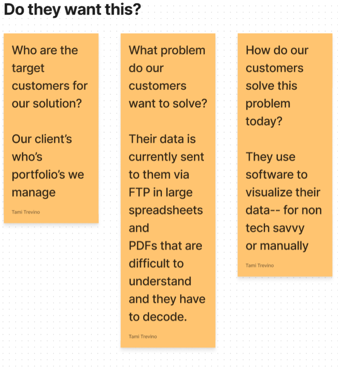

---

## My role

This was my first role in finance. I came from retail, service and healthcare operations, so I learned mortgage servicing from scratch: UPB, delinquency buckets, loss mitigation, escrow, HELOCs. I was the **only designer** on a 12–15 person team. I worked closely with:

- **The project manager**, who ran the schedule and kept us moving
- **The business stakeholder** who fielded investor requests
- **A business systems analyst** who wrote SQL queries to pull the real data points into tables I could design from
- **The lead developer and engineering team**

---

## Discovery

**1. Mapping what we didn't know.** I started with an assumption map: who the customers are, what problem they want solved, how they solve it today, and what could make this fail. Then I worked through the answers with my PM.

**2. Talking to the people closest to the pain.** I interviewed the stakeholder who received investor requests, then wrote interview questions that were passed to investors directly.

**3. Reading the artifacts.** I studied the spreadsheets and PDFs investors were receiving to learn what they actually asked for.

**4. Making the user real.** I built a persona, *Corey Watts*, a 56-year-old banker with a loan portfolio. His pain points: he had to email for every data point, he navigated all over the old Investor Web to find things, and the files he got were too big to use. I mapped a second user's journey: a head of asset management trying to isolate the loans in loss mitigation.

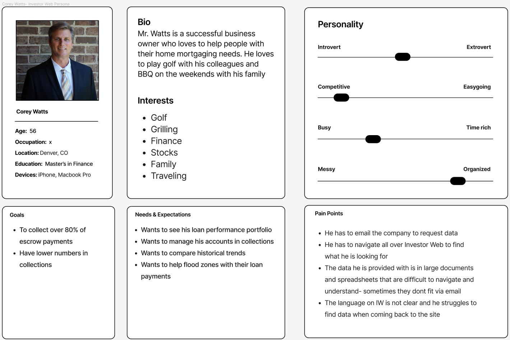
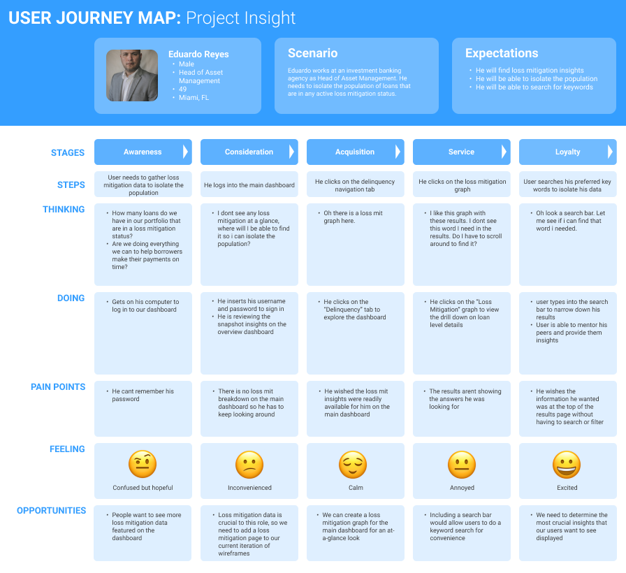

**5. Telling the story.** Two storyboards showed the experience we were building toward. A new loan is onboarded, the investor checks how it affects their portfolio, and the insight leads them to onboard more loans.

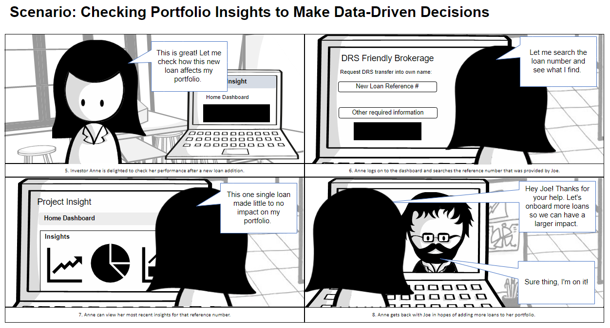

---

## Co-designing the dashboard

I ran **in-person dashboarding sessions** with the stakeholder, the BSA and the project managers. We sketched on whiteboards what investors needed **at a glance** and what belonged one click deeper: delinquency, cashflow, escrow, entries and exits, and disasters.

One sticky note from those sessions changed the product:

> *"Has my portfolio been impacted by natural disasters?"*

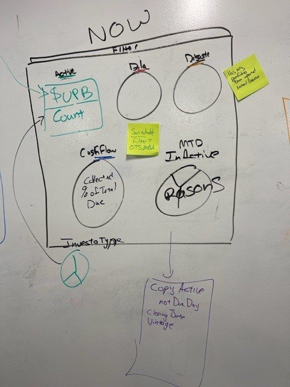
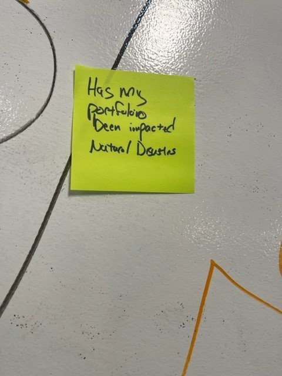

I then mapped the full structure: every tab, every chart, and every drill-down.

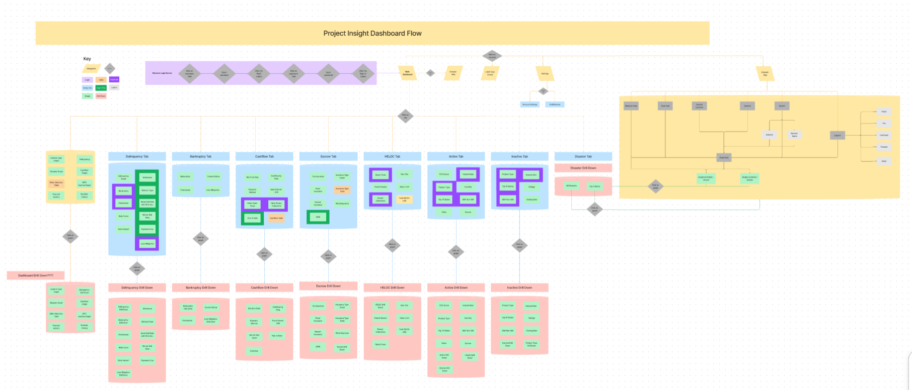

---

## Testing: one dashboard wasn't enough

My first concept (**Prototype A**) was a single at-a-glance dashboard built around the data points we *assumed* mattered most.

After 1–2 rounds of low-fidelity usability testing with **real investors (5 in total)**, the pattern was clear: they wanted **more data at a glance**, including data points we didn't have on the screen at all. So we asked them directly what they needed, and those answers became a **secondary navigation** of focused dashboards.

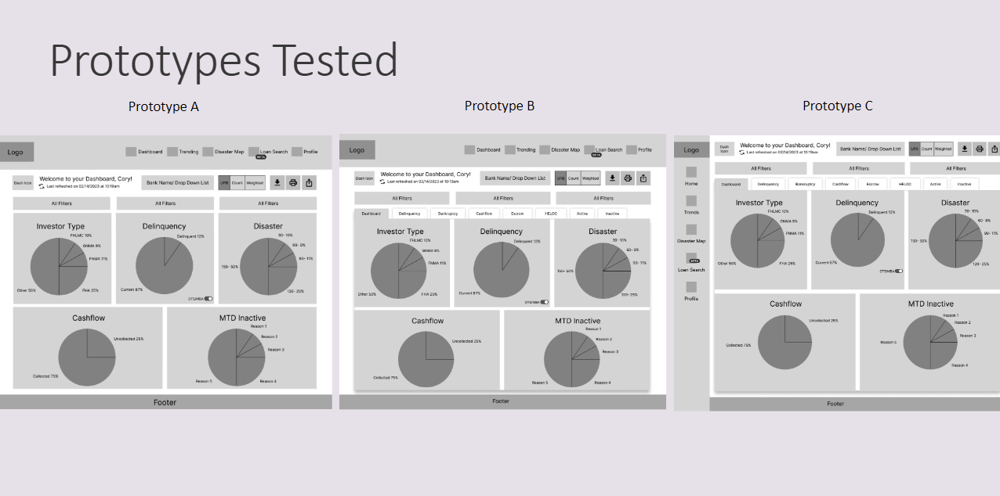

**Prototypes B and C** differed only in where that navigation lived: two rows of tabs on top, or a side nav plus top tabs.

**Finding:** investors had **no preference about placement**. They only cared that the navigation was there.

**Decision:** I brought this to our weekly meeting, and we went with the version we **already had a component for** (side nav + top tabs). When users don't care, engineering effort should decide, and this choice saved design and development time.

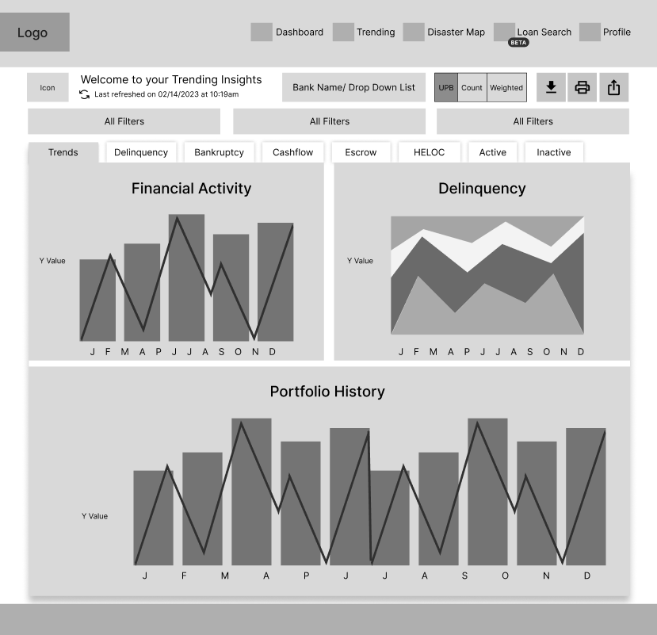

---

## Design decisions

**A suite of focused dashboards instead of one crowded screen.** Main dashboard, Investor Type, Delinquency, Cashflow, HELOC, Active, Inactive and Disaster, each with drill-downs.

**Disasters on their own terms.** Disaster data started on the home dashboard, but when nothing was happening it was just noise. I moved it into its own **Disaster** tab with an embedded **FEMA disaster risk map**, so investors could research when they needed to, without it being forced on them.

**Built for how investors actually work.** A UPB / Count / Weighted-average toggle, year, quarter, month and date filters, column editing, plus download, print and email for the people who still need to share a file.

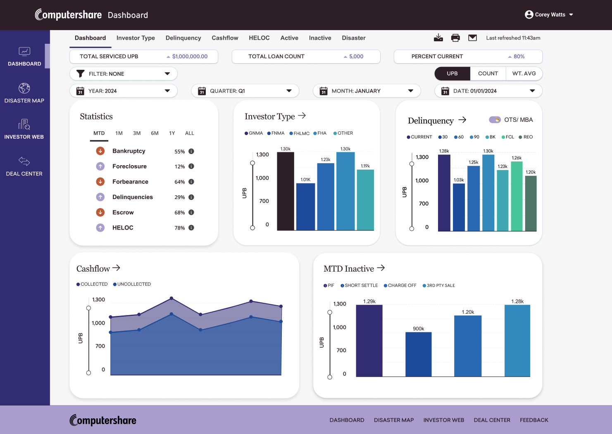
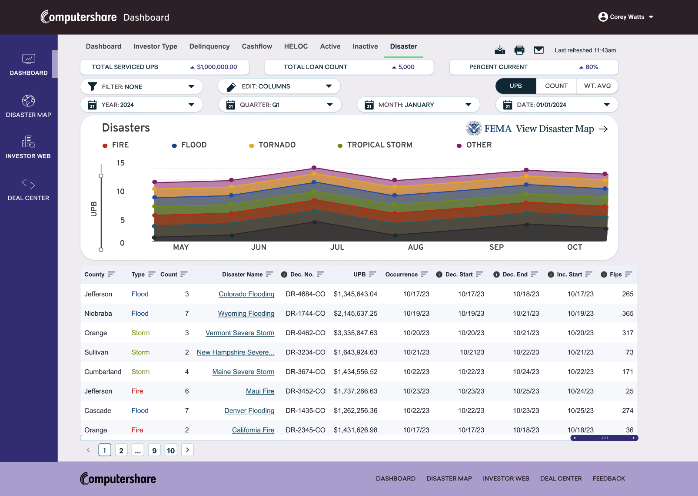
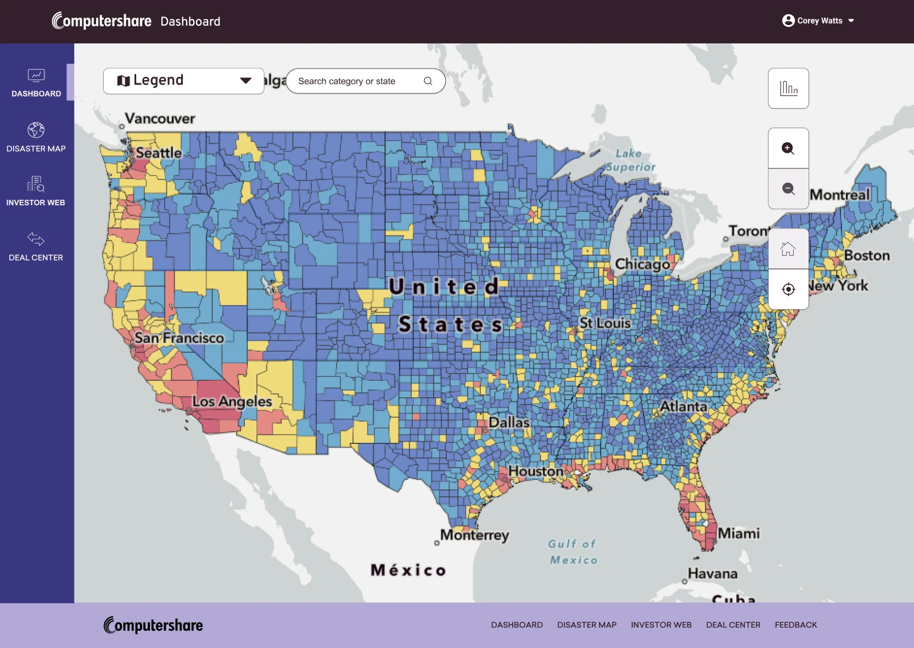

**What we didn't build (yet).** A loan-level research search engine came up in research. I wireframed it, but we chose to put our effort into getting the dashboards right first.

---

## Outcome

At every fidelity level, low, mid and high, investors reacted the same way:

> *"How can I access this?"*
> *"When is this coming out? I need it now."*

The designs were complete and validated, and the data team was already organizing the backend feeds. Then **Newrez acquired the company**. Newrez already had its own investor tool, so Project Insight was cancelled before development started.

The goal was to replace a **3–5 day manual request process** with **self-serve, on-demand insight**. The research and testing showed investors wanted exactly that.

---

## What I'd do differently today

- **Start with a design system:** tokens, reusable components, and documented patterns, so the hand-off is dev-ready from day one. Nobody had taught me documentation then; I've since learned it.
- **Document every decision as I go**, not after.
- **Use AI to move faster.** I took this to high fidelity before AI design tools existed. Today I'd use AI to speed up synthesis, variations and prototyping, and spend that saved time with users.

---

*Data shown in these screens is illustrative.* <!-- [confirm] whether figures are placeholders; blur/replace before publishing if real -->
