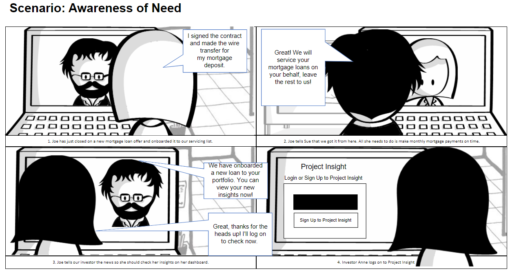

<!-- DRAFT v2: confirmed by Tami on Nov 4, 2026: no colleague names, placeholder data, tools Figma + FigJam. -->

# Project Insight

**Turning a week of spreadsheet requests into a self-serve investor dashboard.**

Impact

Designed self-serve investor dashboards to replace a <strong>3–5 day</strong> manual data-request process. Validated with <strong>5 investors</strong>, who asked <em>“When can I have this?”</em> at every fidelity.

| | |
|---|---|
| **My role** | Sole UX designer, research → high-fidelity prototypes |
| **Team** | Project manager, business systems analyst, stakeholder, 12–15 engineers |
| **Timeline** | Dec 2022 – Feb 2024 |
| **Tools** | Figma · FigJam · Airtable · Azure DevOps |
| **Users** | Investors who own loan portfolios serviced by Computershare |

---

## The problem

Computershare services mortgage loans for investors. To check on a portfolio, investors **emailed a request** for each data point. A stakeholder spent **3–5 days** building spreadsheets and PDFs, sent over FTP, which were long and hard to read.

> Investors wanted answers. They got homework.

**How might we give investors clear insight into their portfolios?**

---

## My role

This was my first role in finance, so I learned mortgage servicing from scratch: UPB, delinquency buckets, loss mitigation, escrow and HELOCs. Our business systems analyst wrote SQL queries to pull the real data I designed from.

---

## Discovery

**1. Mapping what we didn't know.** With my PM, I mapped our assumptions: who the customers are, what they need, how they cope today and what could make this fail. I logged every interview and test finding in **Airtable**, so feedback could be compared and traced to design decisions.

**2. Talking to the people closest to the pain.** I interviewed the stakeholder who handled investor requests and wrote questions for investors.

**3. Reading the artifacts.** I studied the spreadsheets and PDFs investors received to learn what they actually asked for.

**4. Making the user real.** I started with a **proto-persona**, *Corey Watts*, a 56-year-old banker built from our assumption map. After the interviews, I built a research-based persona, *Eduardo Reyes*, a head of asset management, and mapped his journey.

**5. Telling the story.** Two storyboards showed the experience we were building toward.

---

## Co-designing the dashboard

I ran **in-person whiteboard sessions** with the stakeholder, BSA and project managers. We sketched what investors needed **at a glance** and what belonged one click deeper: delinquency, cashflow, escrow, entries and exits, and disasters.

One sticky note changed the product:

> *"Has my portfolio been impacted by natural disasters?"*

Then I mapped every tab, chart and drill-down.

---

## Testing: one dashboard wasn't enough

My first concept (**Prototype A**) was a single at-a-glance dashboard built around the data points we *assumed* mattered most.

After 1–2 rounds of low-fidelity usability testing with **real investors (5 in total)**, the pattern was clear: they wanted **more data at a glance**, including data points we didn't have on the screen at all. So we asked them directly what they needed, and those answers became a **secondary navigation** of focused dashboards.

**Prototypes B and C** differed only in where that navigation lived: two rows of tabs on top, or a side nav plus top tabs.

**Finding:** investors had **no preference about placement**. They only cared that the navigation was there.

**Decision:** I brought this to our weekly meeting, and we went with the version we **already had a component for** (side nav + top tabs). When users don't care, engineering effort should decide, and this choice saved design and development time.

---

## Design decisions

**A suite of focused dashboards instead of one crowded screen.** Main dashboard, Investor Type, Delinquency, Cashflow, HELOC, Active, Inactive and Disaster, each with drill-downs.

**Disasters on their own terms.** Disaster data started on the home dashboard, but when nothing was happening it was just noise. I moved it into its own **Disaster** tab with an embedded **FEMA disaster risk map**, so investors could research when they needed to, without it being forced on them.

**Built for how investors actually work.** A UPB / Count / Weighted-average toggle, year, quarter, month and date filters, column editing, plus download, print and email for the people who still need to share a file.

**What we didn't build (yet).** A loan-level research search engine came up in research. I wireframed it, but we chose to put our effort into getting the dashboards right first.

---

## Outcome

At every fidelity level, low, mid and high, investors reacted the same way:

> *"How can I access this?"*
> *"When is this coming out? I need it now."*

The designs were complete and validated, and the data team was already organizing the backend feeds. Then **Newrez acquired the company**. Newrez already had its own investor tool, so Project Insight was cancelled before development started.

The goal was to replace a **3–5 day manual request process** with **self-serve, on-demand insight**. The research and testing showed investors wanted exactly that.

---

## What I'd do differently today

- **Start with a design system:** tokens, reusable components, and documented patterns, so the hand-off is dev-ready from day one. Nobody had taught me documentation then; I've since learned it.
- **Document every decision as I go**, not after.
- **Use AI to move faster.** I took this to high fidelity before AI design tools existed. Today I'd use AI to speed up synthesis, variations and prototyping, and spend that saved time with users.

---

*Data shown is representative; client information has been anonymized to protect confidentiality.*
