<!-- DRAFT v1: written from Tami's interview notes. [confirm] = quick check before publishing.
     Before publishing the screens: fix "Decreased" → "Deceased" and "sharesinto" in the mockups, replace lorem ipsum, and crop/blur the internal username on the old portfolio screenshot (11). -->

# Bond Centre 2.0

**Redesigning a cluttered bond portal into a calm, guided experience for bondholders and admins.**

Impact

Redesigned a cluttered bond portal for bondholders and admins and <strong>shipped it to production</strong>. The <strong>split navigation won in A/B testing</strong>, and multi-step tasks became guided <strong>3-step wizards</strong>.

| | |
|---|---|
| **My role** | Sole UX/UI designer, from audit to dev-ready designs |
| **Team** | Product owners, project managers, development teams |
| **Users** | **Bondholders** managing their Israel Bonds, and **admins** reviewing and approving their requests |
| **Platforms** | Desktop web + responsive mobile |
| **Tools** | Figma |

---

## The problem

Bond Centre is where people who own State of Israel Bonds check their portfolio, update their details and submit forms. The existing app felt **large, clunky and hard to use**:

- **Cognitive overload:** too many loans and too much data crammed onto one screen
- **Navigation that didn't make sense:** one long menu mixing everyday tasks with account settings
- **Weak admin controls:** staff had no clear way to review, approve or reject what bondholders submitted

---

## Two users, two jobs

| **Bondholders** | **Admins** |
|---|---|
| See what they own and what it's worth | Review submitted forms and documents |
| Download statements and tax forms | Approve or reject requests |
| Update banking, address and communication preferences | Keep bondholders informed of the status |

Designing for both meant every flow had two sides: what the bondholder does, and what the admin sees next.

---

## 1. Navigation: separating *doing* from *managing*

I tested **one long left-hand menu** against a **split navigation**:

- **Left:** the tasks you came to do (Portfolio, Payments & Transactions, Banking Details, Account Statements, Suppress Maturity Payment)
- **Top right:** everything about *you* (Alerts, Messages, country, User Preferences, Help & FAQ, Logout)

**The split navigation won.** With everything stacked on the left, people found it busy and confusing. Splitting it follows a pattern people already know from the apps they use every day.

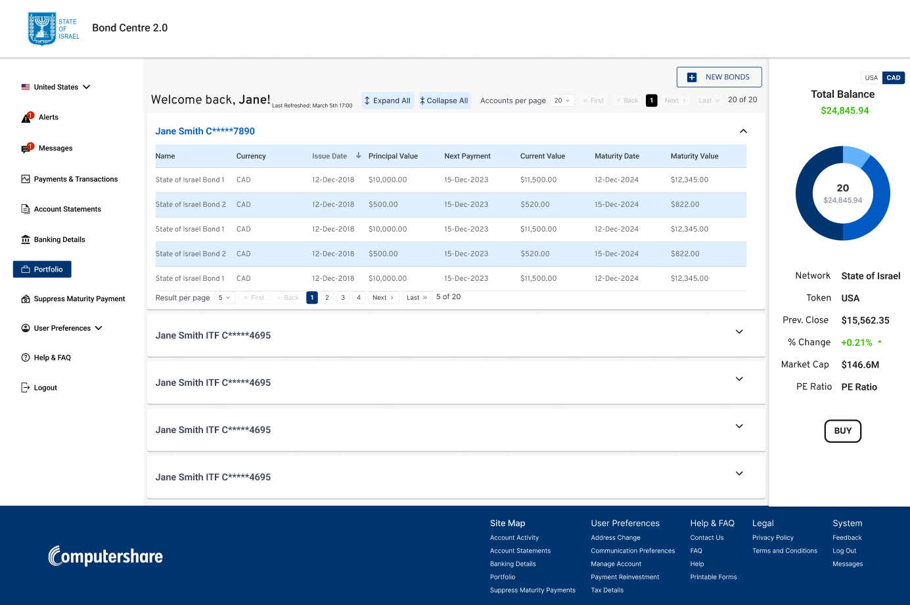
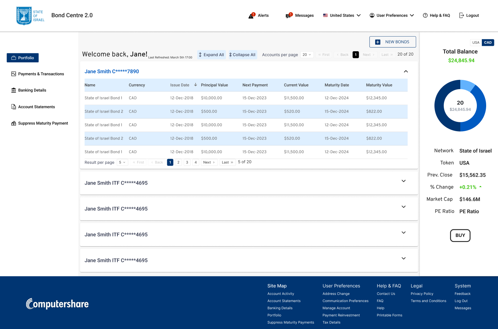

---

## 2. Taming the data: accordions + pagination

Some bondholders hold **many bonds across many accounts**. Instead of showing everything at once:

- Each account is an **accordion**, closed until you need it, with **Expand all / Collapse all**
- Inside, bonds sit in a **short, paginated table**, and users choose how many rows to see
- A summary panel shows the **total balance** at a glance, with a **USD / CAD** toggle

The bondholder decides how much information is on screen, not the system.

---

## 3. Wizards for multi-step tasks

Updating communication preferences across several accounts used to be one dense form. I turned it into a **3-step wizard**:

1. **Select accounts:** checkboxes, with select-all
2. **Choose preferences:** email or postal mail for tax statements, bond statements and other mail
3. **Review the summary:** "Your information is not complete until you click Submit"

…followed by a clear **success confirmation**. A stepper shows where you are, and you can always go back.

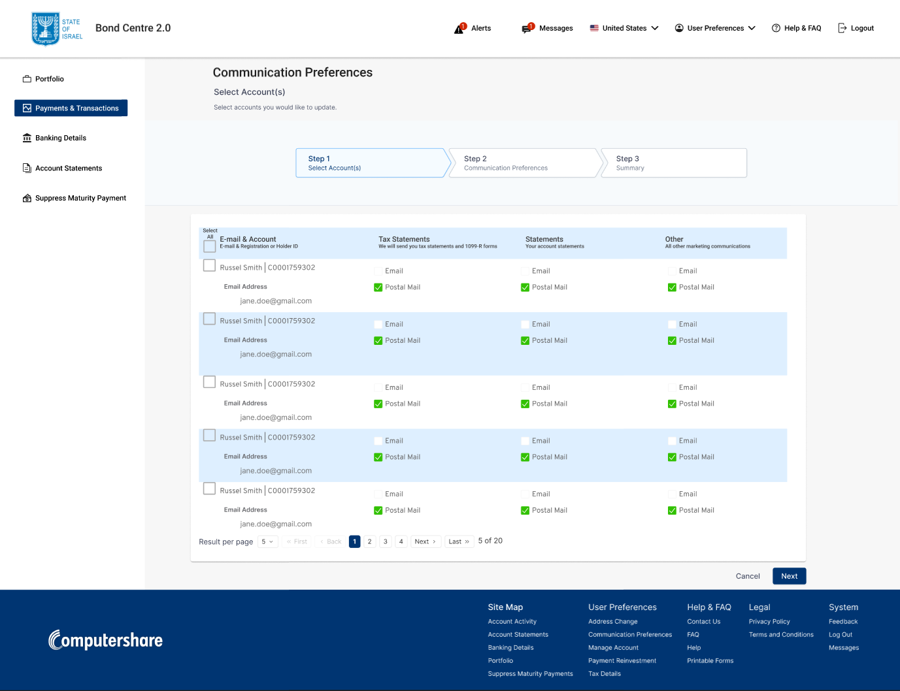
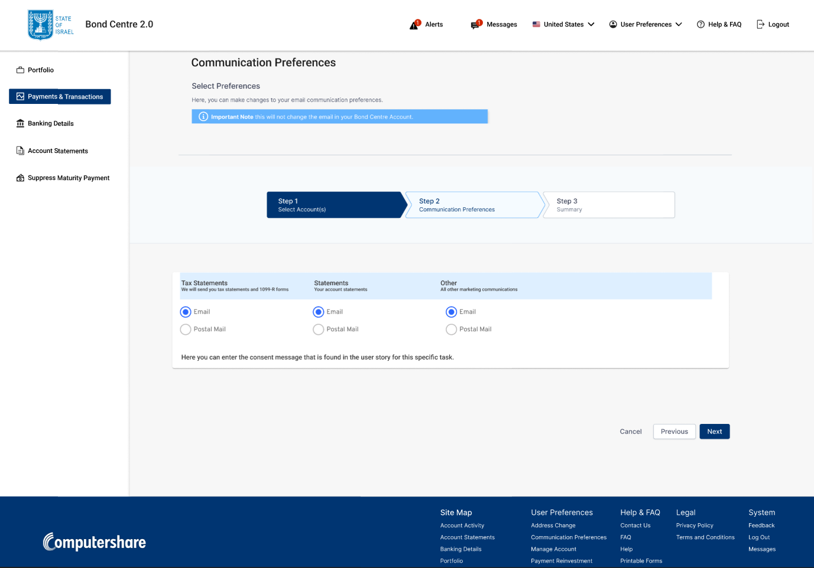
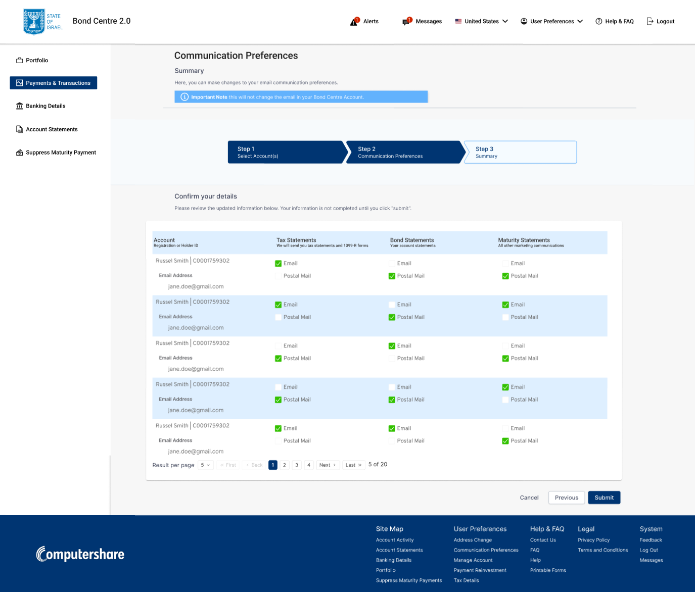
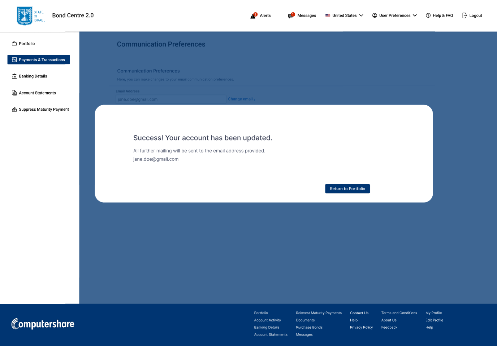

---

## 4. Forms and uploads without losing your place

Printable forms are grouped into accordions: US holders, international holders, tax forms, direct registration, international currency. Bondholders can **view a form and upload the signed copy right inside the section**: drag and drop, a progress bar, an "Uploaded ✓" state, and a **Remove file** option if they picked the wrong one.

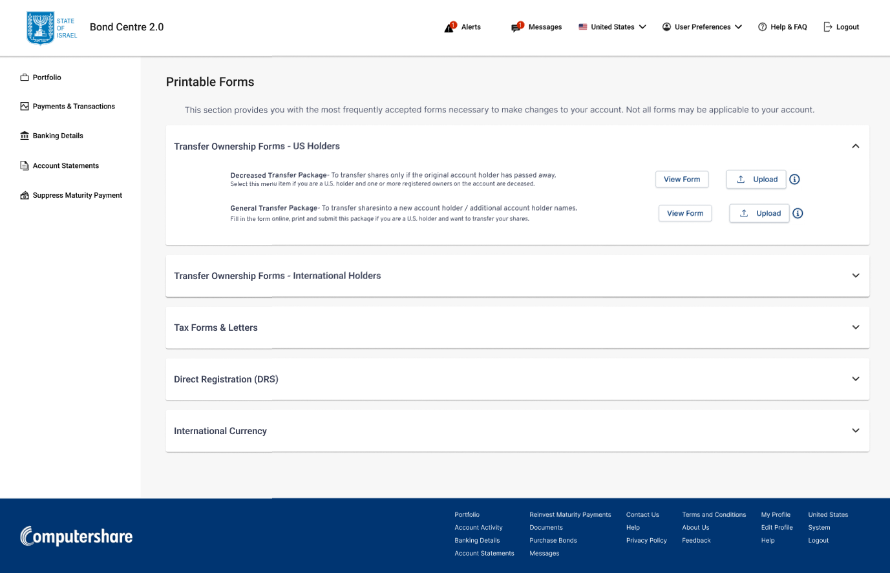
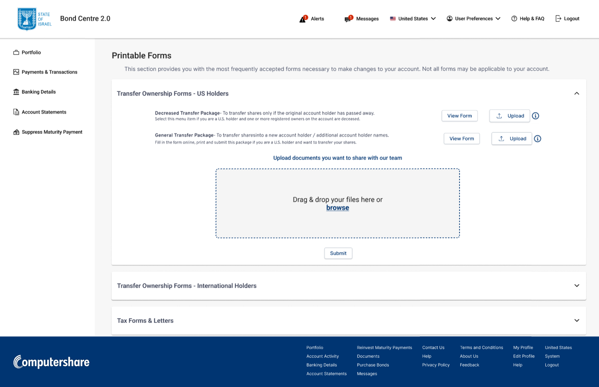
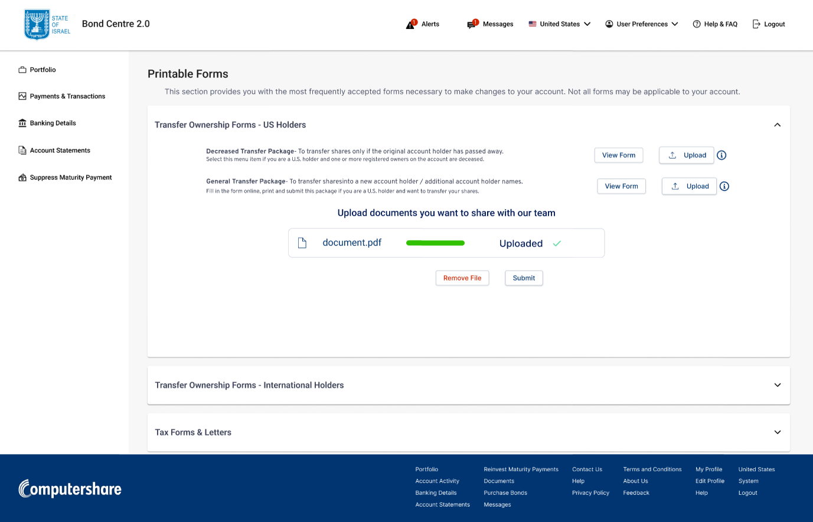

---

## 5. Admin controls that close the loop

When a bondholder submits a form, the **admin** sees it marked **Proposed**, with **Preview, Approve, Reject and Cancel** actions. The **bondholder** then sees the result (for example, **Rejected**) right next to the form, with an info icon explaining what happened. No more guessing whether a request went through.

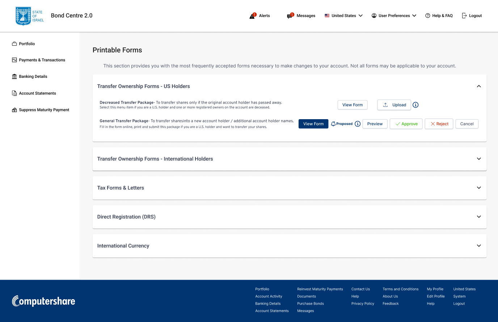
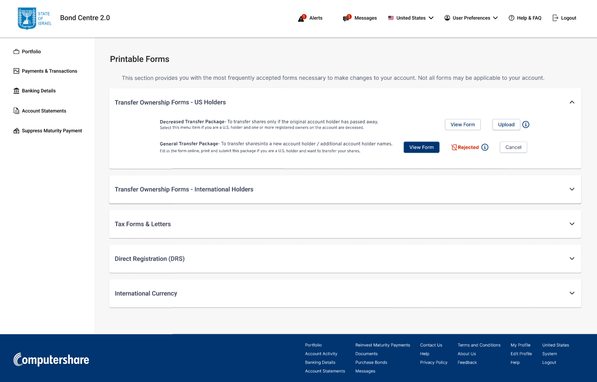

---

## 6. Designed for every screen

I designed the full product for **desktop and mobile** (iOS and Android sizes): portfolio, tax details, printable forms, communication preferences, FAQ, inbox, online support, banking details and address change.

For the mobile **Inbox**, I compared two layouts:
- **A:** message list and message detail on separate screens
- **B:** message detail stacked above the list

**A won:** it was more intuitive, because it works like the email apps people already use.

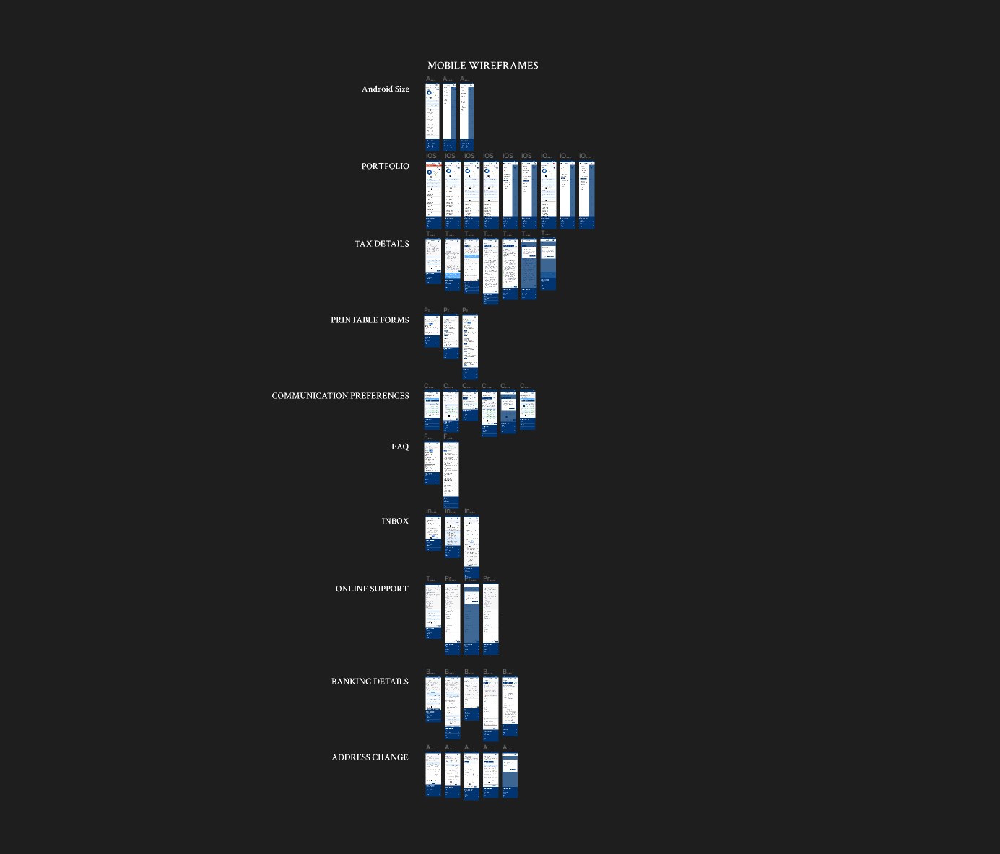
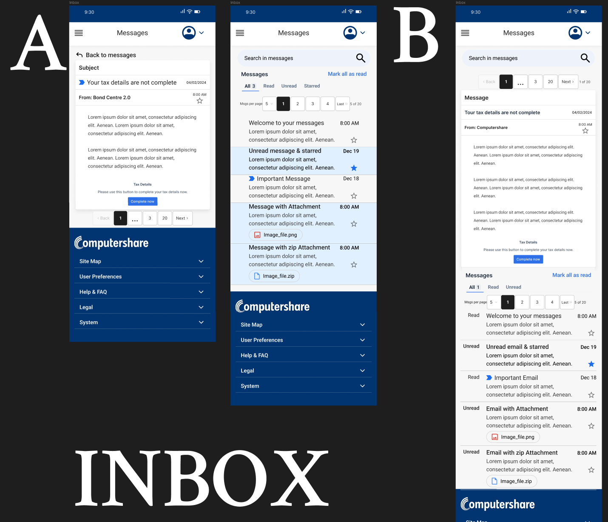

---

## Outcome

**Bond Centre 2.0 shipped to production.** The development team and product owners were excited about the upgrade: a cleaner, calmer, more organized experience for bondholders, and real controls for admins.

I was part of a company-wide layoff shortly after launch, so I wasn't able to collect post-launch usage data.

---

## What I learned

- **Research turns unknowns into solutions.** I didn't start with every answer. Researching proven patterns led me to the accordions and wizards that solved the clutter.
- **Component libraries raise the bar.** Building with Figma component libraries helped me reach a polished, consistent look quickly.
- **Next time: a real handoff.** I'd deliver clear handoff documentation (specs, states and interaction notes) instead of leaving developers to work out how to build my designs.
