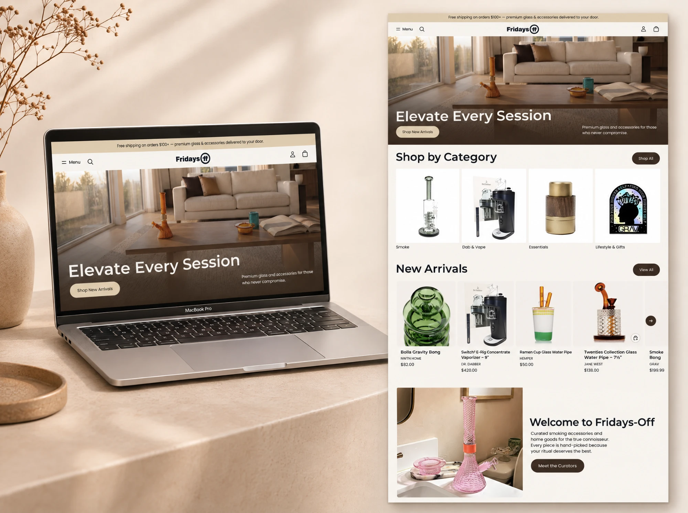
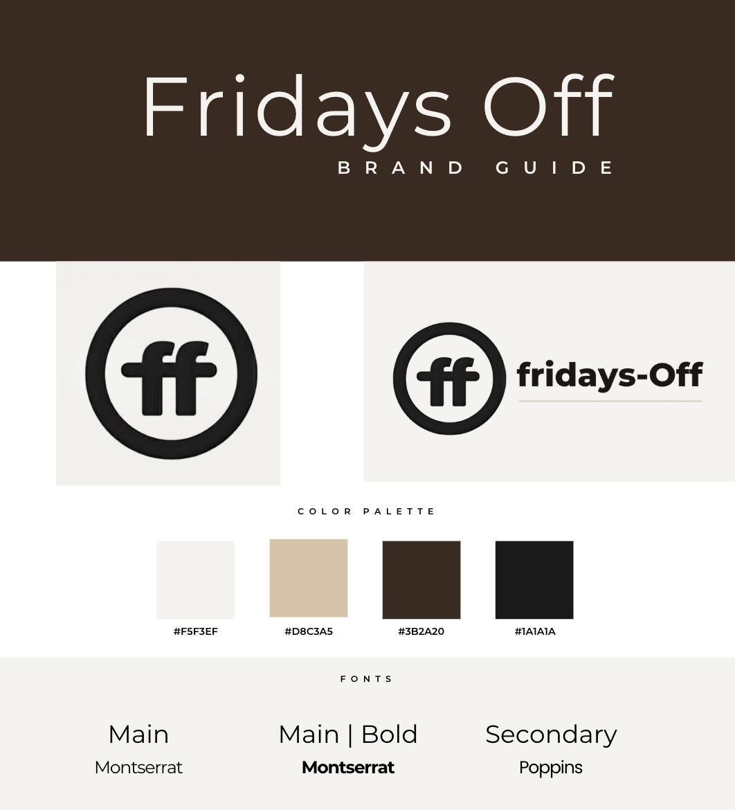
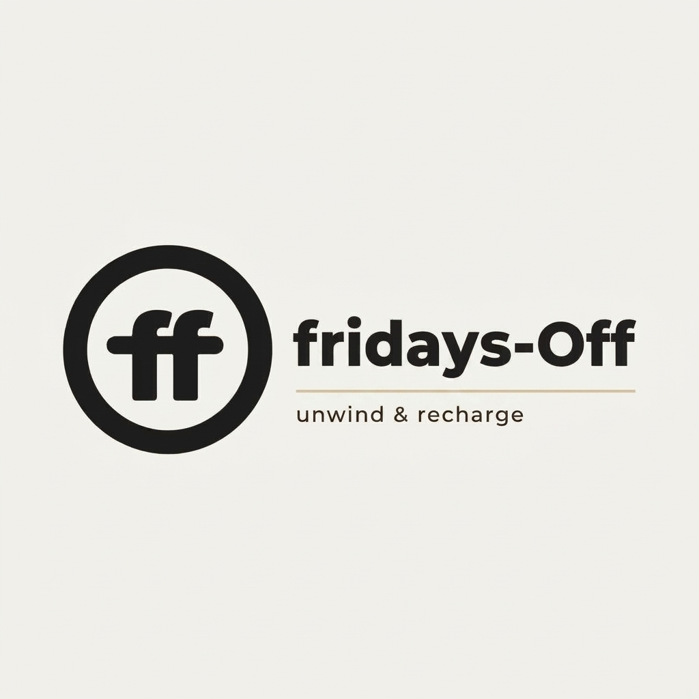
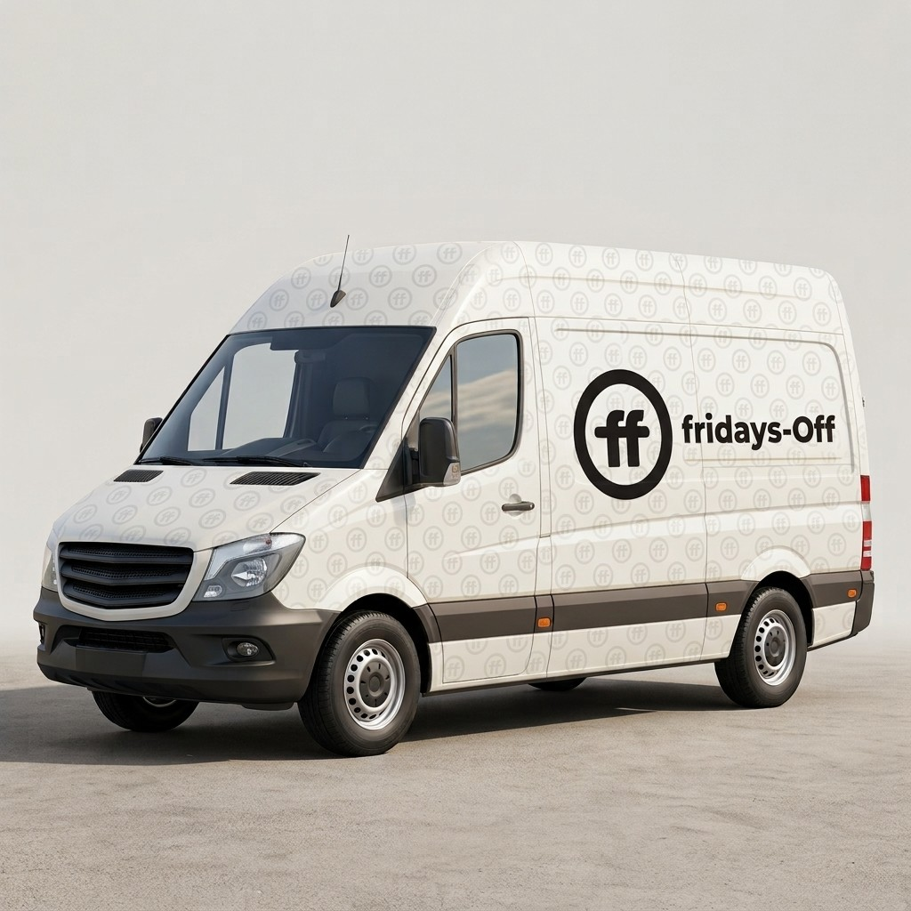
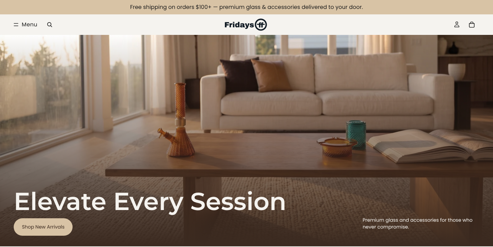
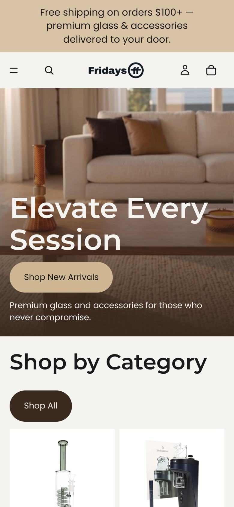
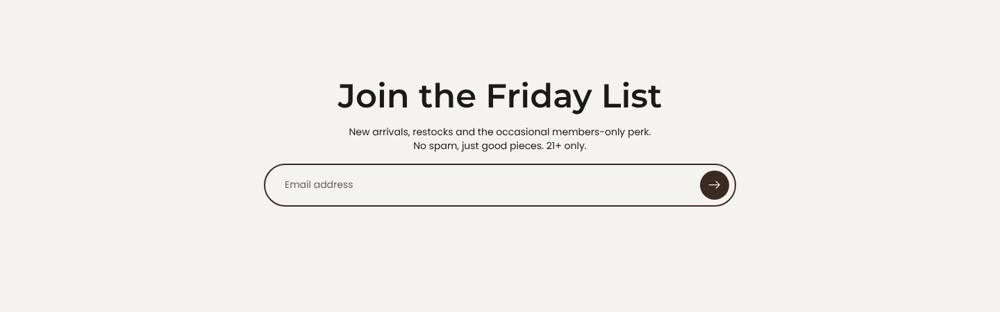

<!-- DRAFT v2 (Tami: describe as lifestyle products / home goods only; no smoking or cannabis wording).
     DRAFT v1: written from Tami's interview notes + live Shopify data (Nov 3–4, 2026).
     [metrics] sections get real numbers 30–60 days after the social launch. -->

# Fridays-Off

**Building a luxury lifestyle brand and e-commerce store from zero, with an AI-powered content engine.**

<div class="impact" markdown="0">
<p class="impact-label">Impact</p>
<p>Co-founded a luxury lifestyle brand and built its <strong>460+ product</strong> store (<strong>~48 brands</strong>): <strong>keyboard- and screen-reader accessible</strong>, <strong>WCAG AAA</strong> contrast, and an <strong>AI content pipeline</strong> that keeps a two-person team publishing weekly.</p>
</div>




| | |
|---|---|
| **My role** | Co-founder · brand, web and marketing design lead |
| **Scope** | Brand · Shopify design + build · IA · Accessibility · AI pipeline |
| **Tools** | Shopify · Claude + Claude Code · Higgsfield · Notion · Blotato |
| **Status** | Live at **[fridays-off.co](https://fridays-off.co)** |

---

## The idea

Most shops in this space feel cluttered, loud and cheap. Fridays-Off is the opposite: **a Louis Vuitton-level experience for lifestyle products and home goods**, curated for people who care how things look on their shelf.

For my co-founder and me, it's personal: a business built on our own terms.

---

## Who does what

We designed the brand together. Then:

| Me | My co-founder |
|---|---|
| **Designed and built the entire website** | Logistics and suppliers |
| Accessibility | Product research |
| Launch design assets | Copy and brand voice |
| **Marketing execution + automation** | Marketing strategy, UX feedback |

---

## 1. The brand: quiet luxury

**Research first.** We studied **Louis Vuitton** and premium lifestyle brands, then borrowed their best patterns: whitespace, editorial photography and calm type.

- **Mark:** an "ff" ligature in a circle that works as a logo, stamp and pattern
- **Name:** **Fridays-Off**, with a capital F and O. On merch, "F-Off" becomes a wink.
- **Tagline:** *unwind & recharge*
- **Type:** Montserrat + Poppins
- **Palette:** four warm neutrals

| Cream | Sand | Espresso | Near-black |
|---|---|---|---|
| `#F5F3EF` | `#D8C3A5` | `#3B2A20` | `#1A1A1A` |

<div class="pair wide trio" markdown="1">



</div>

---

## 2. The store: 460+ products that still feel curated

**Information architecture.** I organized 460+ products into **three shopping pillars** with sub-categories, so any product is at most two taps away. **Shop by Brand, New Arrivals, Best Sellers, Travel Essentials** and **Lifestyle & Gifts** let people browse by mood, brand or need.

**The homepage** reads like a magazine, not a catalog, and ends with **Join the Friday List**.

**Product pages** stay clean: a large gallery, clear specs, Shop Pay installments, and accordions for details and shipping.

<div class="pair wide trio" markdown="1">



</div>

**Responsible by design.** An **age verification gate** greets every visitor.

**How I built it.** I compared three Shopify themes, chose **Tinker** and customized it. For deeper changes, I **paired with Claude on custom CSS and theme code**, so a team of two shipped a custom store without hiring a developer.

---

## 3. Accessible, always

Accessibility wasn't a final check. It was a requirement from day one.

- **Keyboard navigation** and **screen-reader support** across the store
- **Minimal layouts** to avoid cognitive overload
- **Color contrast checked against WCAG**:

| Pair | Contrast | Result |
|---|---|---|
| Near-black on cream | 15.7 : 1 | ✅ AAA |
| Espresso on cream | 12.3 : 1 | ✅ AAA |
| Sand on near-black | 10.2 : 1 | ✅ AAA |
| Espresso on sand | 8.0 : 1 | ✅ AAA |
| Sand on cream | 1.5 : 1 | Decoration only, never text |

---

## 4. The AI content engine

A two-person team can't shoot hundreds of lifestyle photos. So I built a **content pipeline** that keeps everything on-brand:

```
Brand style guide  +  Notion reference library (curated by my co-founder)
                  ↓
        Claude writes consistent image prompts
                  ↓
        Higgsfield generates on-brand product imagery
                  ↓
        Blotato schedules the week's posts automatically
```

The Notion library of motion and art references is what keeps the images from looking "AI-generated." Every prompt is anchored to real visual references and to our style guide. The goal is a **hands-free content week**: plan once, and the system publishes.

On the website we use **curated supplier photography**. On social, we use the AI-generated editorial imagery, so both channels match one visual language.

<!-- Add: 6–9 tile Instagram grid screenshot once posted -->

---

## 5. Keeping the store healthy

Dropshipping hundreds of products from dozens of brands creates mess: duplicate brand names, duplicate categories, empty brand pages. I cleaned up the duplicates and set up an **automated weekly store check** that reports issues before customers ever see them.

---

## Status and early feedback

- **The store is live** at fridays-off.co. The social launch is underway.
- In soft-launch previews, people **loved the aesthetic, the photography and the overall vibe**.
- <!-- [metrics] Add after 30–60 days: visitors, email signups (Friday List), conversion rate, first orders, top post reach. -->

---

## What I learned

- **Great brands borrow wisely.** Studying luxury and high-end brands taught me how to find inspiration and translate it into our own identity.
- **One source of truth keeps a remote team in sync.** My co-founder and I each work with our own AI agents in Claude, but we pull from and update the same Notion library, so our work never drifts apart.
- **AI and automation multiply a small team.** I built Claude skills and automations, created stunning AI product renders in Higgsfield, and automated content creation and scheduling through Blotato.
- **E-commerce is part design, part systems.** Connecting dropshipping suppliers in Shopify and rewriting existing product copy in our brand voice taught me how product data, inventory, copy and design have to work together.
