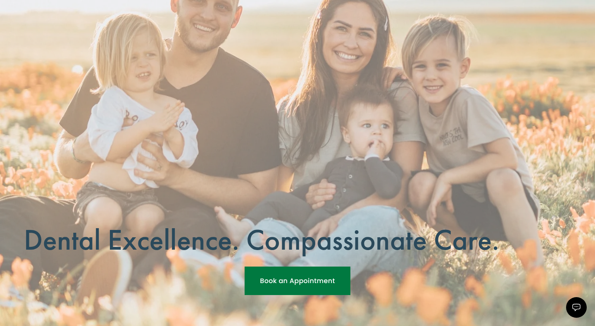
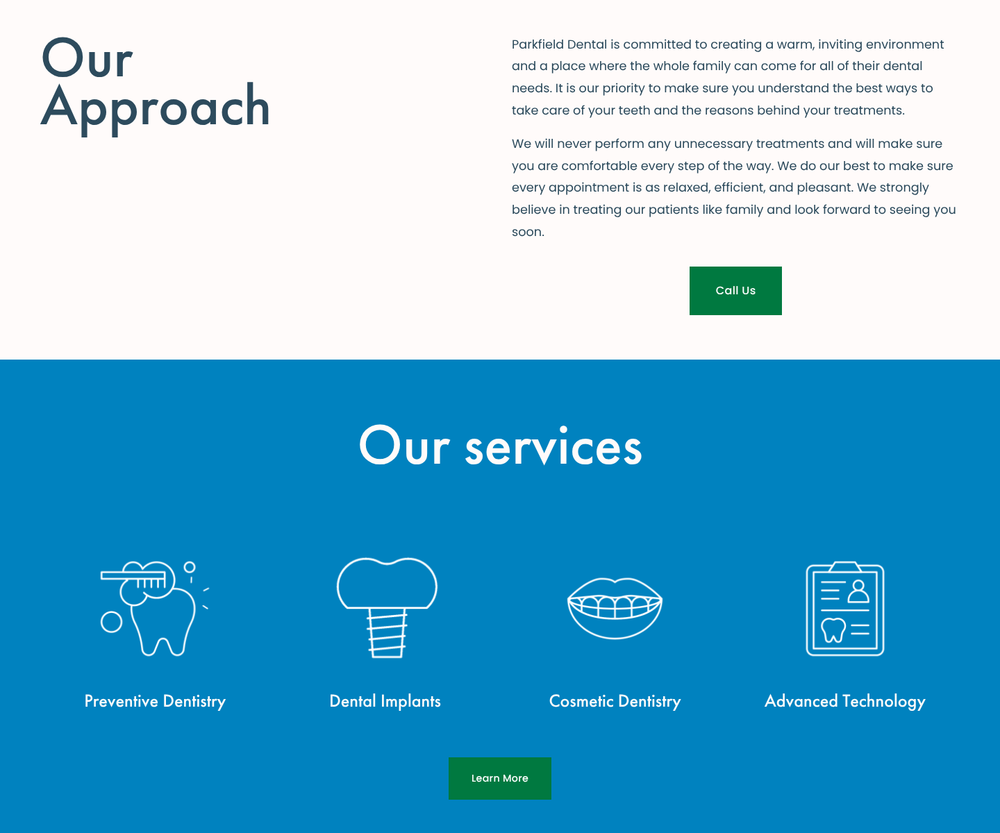
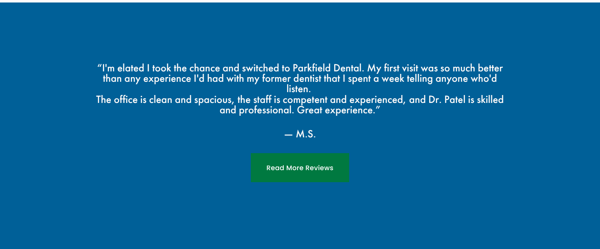
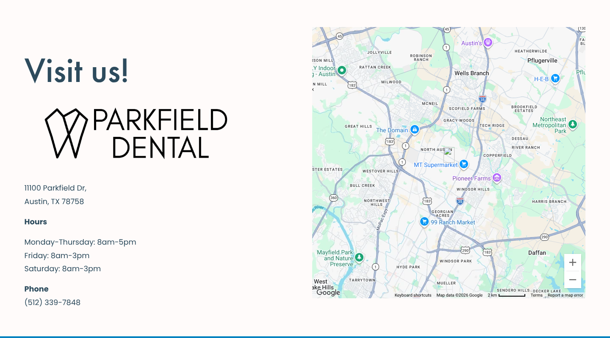

<!-- DRAFT v1: written from Tami's interview notes + live-site capture (Nov 4, 2026).
     Client changes after launch (per Tami): a second row of nav items, the pixelated waiting-room photo, parts of the contact page, translator removed.
     Portfolio crops in assets/dental/parkfield/portfolio/ show only Tami's original work (desktop hero cropped below the nav; the mobile view has her single hamburger menu). -->

# Dental Brands & Websites

**Two dental executives launched new ventures, and both came back to hire me.**

Impact

<strong>Two executives</strong> from the same company each hired me for their next venture. For <strong>Parkfield Dental</strong>, I created a <strong>full brand identity and website</strong> on one design system, <strong>bilingual (English/Spanish) at launch</strong> and built for accessibility. For <strong>Evolve Dental Partners</strong>, I built a <strong>brand-compliant website</strong> and handed it off so the founder could manage it herself.

I worked inside a dental support organization (DSO) in Austin, first at the front desk, then as office manager, while also running the practice's website and blog. Two of its leaders went on to start their own businesses. Both called me.

| | **Parkfield Dental** | **Evolve Dental Partners** |
|---|---|---|
| **Client** | The DSO's former VP of Operations, who bought an established practice | The DSO's former CEO, a hygienist-turned-founder |
| **I delivered** | Full brand identity + website | Website built on the client's existing brand |
| **Tools** | Illustrator, Squarespace | Squarespace |
| **Highlights** | Bilingual (English/Spanish) at launch, accessible, cohesive design system | Brand-compliant build, handed off for the founder to edit herself |
| **Status** | Live at **[parkfieldfamilydental.com](https://www.parkfieldfamilydental.com)** | Handed off; site currently offline |

---

## Parkfield Dental: a modern brand for an established practice

### The problem
My former VP of Operations bought an Austin dental practice that already had loyal patients, but its **branding and marketing felt dated**. He wanted the practice to look and feel like the modern, caring office it was becoming, without losing the families who already trusted it.

### What I designed
**A new identity, built from zero (Illustrator).** A geometric, single-line **tooth mark** paired with a clean, all-caps wordmark: precise like dentistry, open and friendly like family care.

**A website built on the same design system (Squarespace).** Same type, same palette, same calm tone, from the logo all the way to the booking button.

- **A warm, human first impression:** *"Dental Excellence. Compassionate Care."* over a real family moment, with **Book an Appointment** always one tap away
- **Custom line icons** for each service (preventive care, implants, cosmetic, technology) that echo the logo's single-line style
- **Clear paths for patients:** a single, simple navigation row, plus a "Visit us" section with hours, phone number and map
- **Responsive:** designed to work just as well on a phone

### Designed for the whole community
Austin has a large Latino community, and many patients only speak Spanish. At launch, I built the site with a **site-wide English/Spanish translator**, so every page (services, insurance, booking) could be read in the patient's own language. I also designed for **accessibility**: readable type, strong contrast, and clear, consistent buttons.

This one is personal. I moved from Monterrey, Mexico to Texas when I was nine and started school in an ESL class. I know what it feels like when a place isn't built for you. I want the places I design to feel like they are.

*Note: the client has updated the live site since launch, and the translator is no longer active. The work shown here is my original design.*

---

## Evolve Dental Partners: building the foundation, then handing over the keys

### The client
The DSO's former CEO is a **dental hygienist turned serial entrepreneur**. She builds companies that support hygienists and help clinics run hygiene better, then sells them. When she started her next venture, **Evolve Dental Partners**, she asked me to build its website.

### What I did
- Took her **existing logo and brand guidelines** and translated them into a clean, credible **Squarespace site**
- Structured the site so a busy founder could **update it herself**
- Collaborated closely, then **handed it off**. She loved working in Squarespace and took over editing from there.

The goal wasn't a site she'd depend on me for. It was a site she could run.

<!-- No screenshots available: the site is currently offline. Add Wayback Machine captures if found. -->

---

## Results

- **Repeat trust:** two executives from the same company each came back to hire me for their next venture.
- **Parkfield** got a brand and website that matched the modern, family-centered practice it was becoming, and served its Spanish-speaking patients at launch.
- **Evolve** launched with a brand-compliant site its founder could manage on her own.

## What I learned

- **A brand is a system, not a logo.** Designing the logo and website together kept everything consistent, down to the icons.
- **Inclusive design is a business decision.** Speaking your patients' language is good care and good marketing.
- **Plan for the handoff.** Clients will keep editing after launch. Next time I'd deliver a one-page brand and site guide (fonts, colors, image specs, do's and don'ts) so the site stays sharp, and I'd keep my own launch screenshots.
