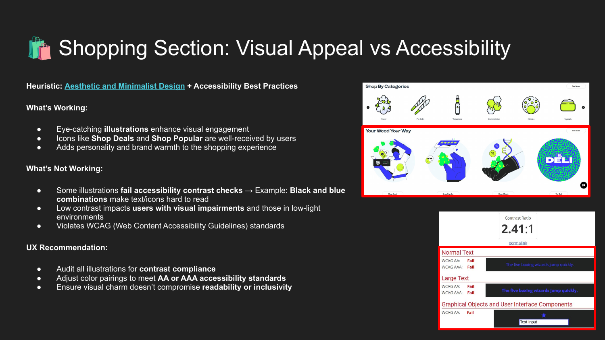
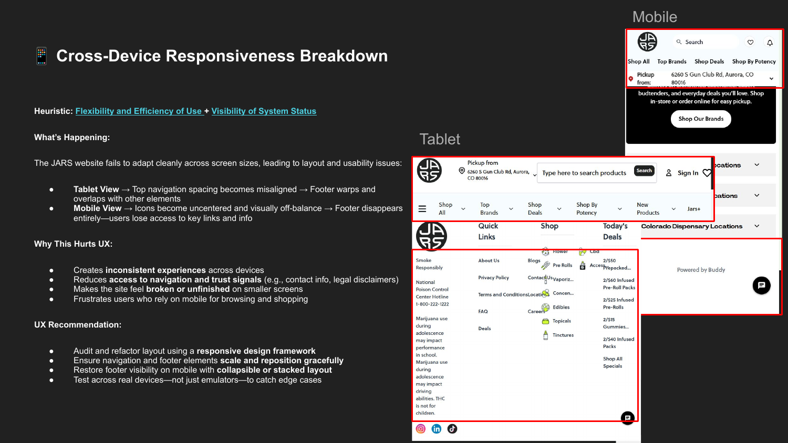
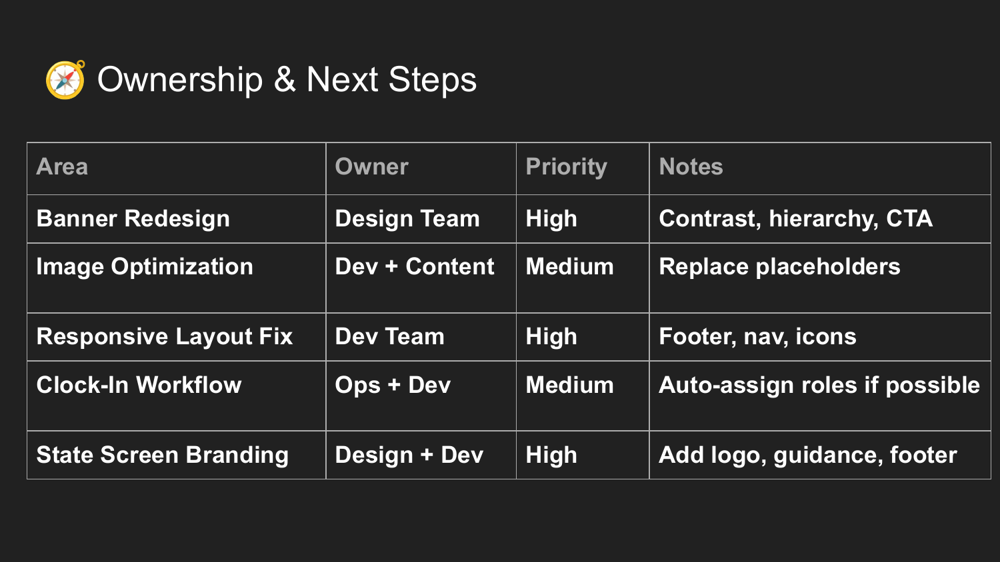
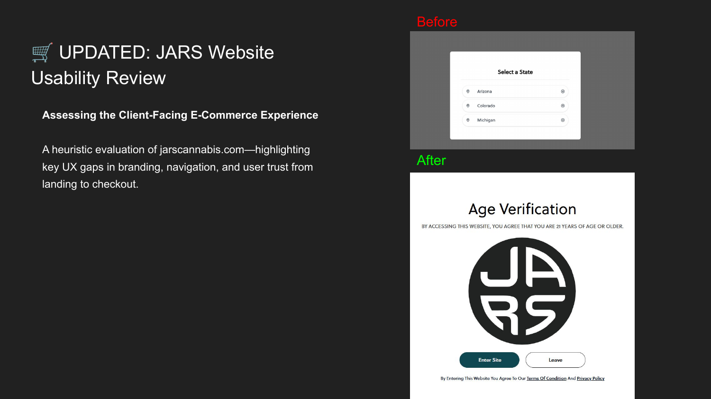
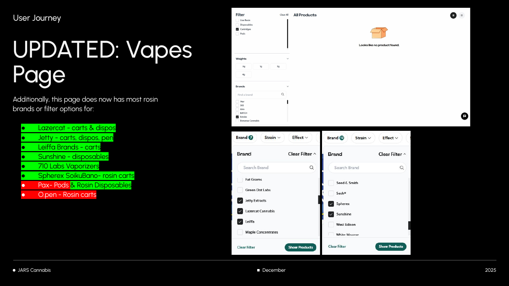
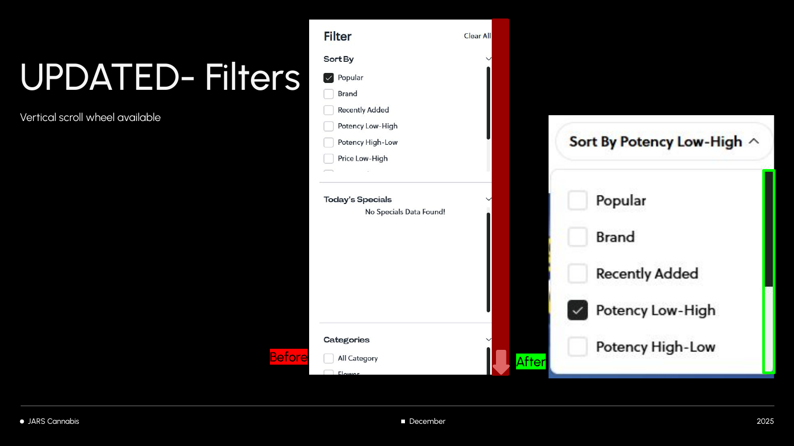
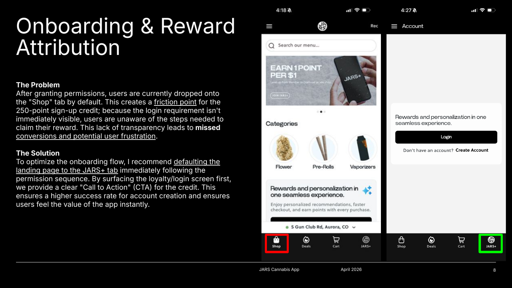
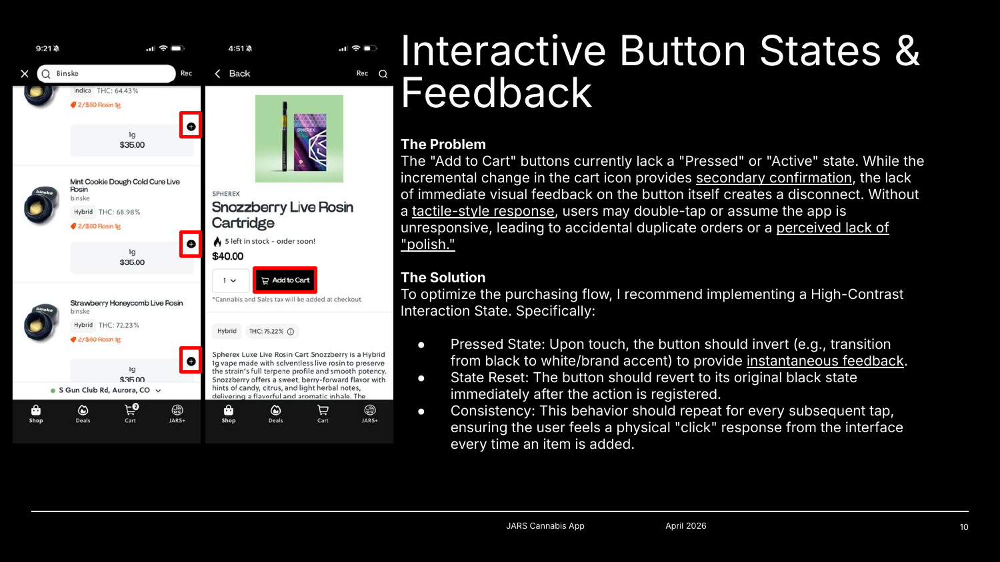
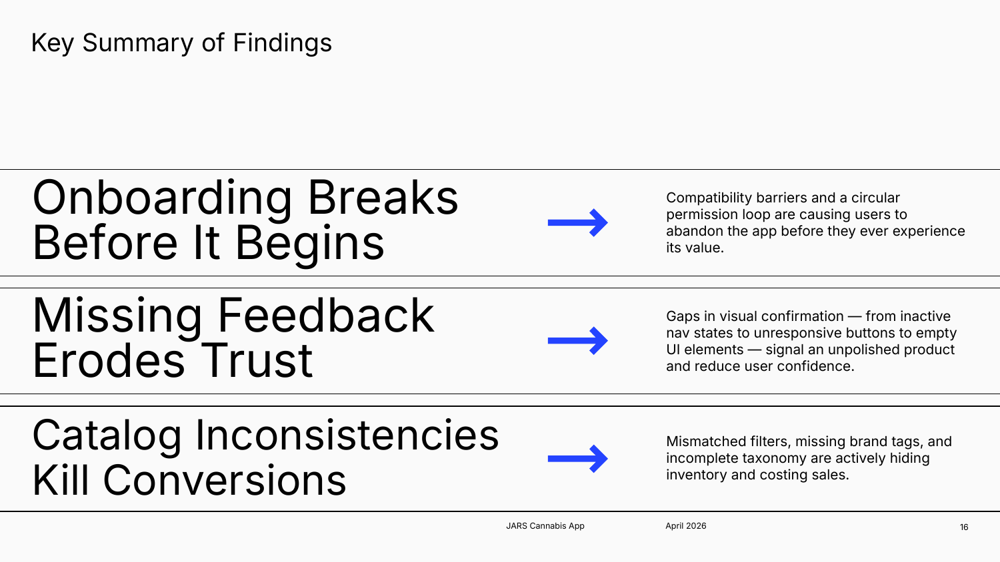

<!-- DRAFT v1 (Nov 6, 2026) from Tami's three PDF decks. Framing: "self-initiated" (Tami). Never use: Audit 3 HR-portal pages, clock-in codes, headshot/work email. -->

# Jars UX Audits

**Self-initiated usability reviews of a retailer's website, online menu and app, done while leading the sales floor.**

Impact

Three self-initiated audits across <strong>4 platforms</strong>: website, online menu, mobile app and staff portal. After my reviews, the live site changed to match several recommendations, including <strong>6 of 8 hidden brands</strong> made findable.

| | |
|---|---|
| **My role** | Floor lead; UX audits on my own initiative |
| **Methods** | Nielsen's 10 heuristics · WCAG contrast checks · task walkthroughs · cross-device review |
| **Platforms** | Website · online menu · iOS + Android app · staff portal |
| **Timeline** | Sep 2025 – Apr 2026 |

---

## The spark

On the floor, I watch customers use our website and app every day. When a customer couldn't find a product online that we had in stock, I wondered: what else is hidden? So I started auditing.

---

## 1. Website and staff portal (Sep 2025)

A heuristic evaluation against **Nielsen's 10 heuristics**, with WCAG contrast checks on web, tablet and mobile.

- **Low-contrast banners:** one measured **2.41:1**, failing WCAG AA
- **Footer disappears on mobile;** it warps on tablet
- **Bare state-selection screen:** no logo, navigation or explanation
- **Staff clock-in:** 6 steps, with a path to 4

I closed with a priority table for leadership: **3 High, 2 Medium**, each with an owner team.

---

## 2. Online menu (Dec 2025)

A task walkthrough that retraced the customer's search.

- **8 brands missing** from the Brands filter, though they had brand pages
- **Sort By used checkboxes** for a single choice; it should use radio buttons
- **No visible scrollbar,** so shoppers couldn't tell more filters existed
- **A new store still said "Coming Soon"** after it opened

My re-check showed **6 of 8 brands** now findable, a visible scrollbar and the correct store status.

---

## 3. Mobile app (Apr 2026)

**10 findings** on iOS and Android, each written as Problem → Solution, grouped into three themes:

- **Onboarding breaks before it begins:** an age-permission loop, and a 250-point sign-up reward hidden on the wrong tab
- **Missing feedback erodes trust:** no pressed state on Add to Cart, which invites double orders
- **Catalog inconsistencies kill conversions:** filters and tags that hide items in stock

---

## What I learned

- **Real-world use finds real problems.** Jars launched its website and app without an in-house UX designer. Frustrated customers showed us what was broken: features that didn't work, and online inventory that didn't match the store.
- **User testing is crucial.** It shows how a product actually works for people, surfaces their pain points and leads to the right solutions.
